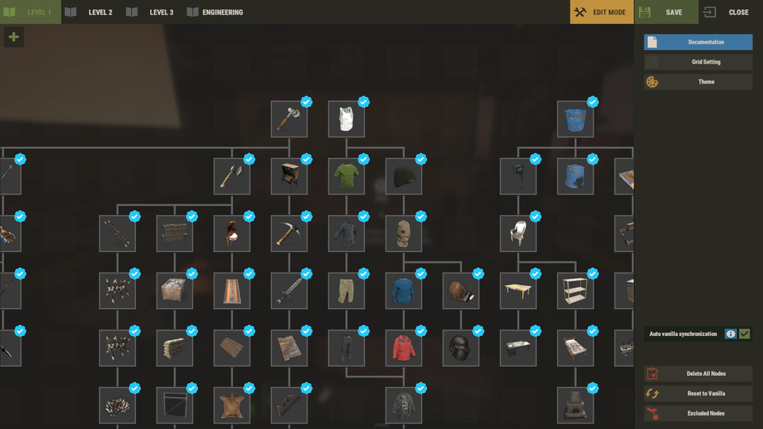
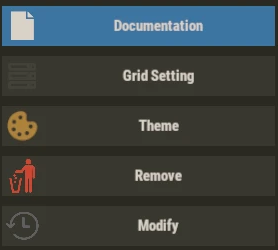
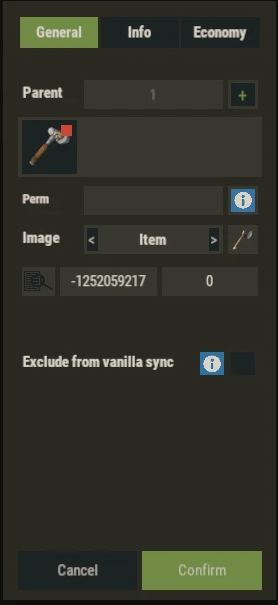
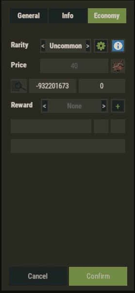

# Admin Editor

**TechTree** includes an in-game admin editor for building and maintaining the tree.

The editor is designed so you can adjust progression without manually editing JSON files for every change.

---

## Who Can Edit

The editor is available to **Rust admins** (server admin or auth level).

It is not controlled by a permission.

---

## Edit Session

- Open **TechTree** at a workbench.
- Click `PLAYER MODE` in the top bar to switch to `EDIT MODE`.
- Make your changes.
- Click `SAVE`.

Everything you change goes into a **draft** first.

Nothing is written to disk until you click `SAVE`.

**Important:** switching back to `PLAYER MODE` or clicking `CLOSE` throws away unsaved changes, without confirmation.

A few actions are saved immediately, outside the edit session:

- `Reset to Vanilla`. It also cancels the current edit session.
- The economy model and `APPLY TO ALL NODES` in the rarity prices panel.
- Every action in the theme modal.

---

## Top Bar

- Workbench tabs: `LEVEL 1`, `LEVEL 2`, `LEVEL 3`, `ENGINEERING`.
- Subcategory tabs, with the settings and `+` buttons. See **Subcategories**.
- `EDIT MODE` / `PLAYER MODE`: shows the current mode, click to switch.
- `SAVE`: writes every change of the session and returns to player mode.
- `CLOSE`: cancels the session and closes TechTree.

---

## Right Panel

- `Documentation`: opens this documentation in game.
- `Grid Setting`: resizes the grid. See **Node Placement And Lines**.
- `Theme`: opens the theme modal. See **Themes And Node Styles**.
- `Add`, `Remove`, `Modify`: shown when a cell or a node is selected.
- `Update Grid`: shown when the grid bounds need a refresh.
- `Auto vanilla synchronization`: main tree only. See **Vanilla Sync And Custom Trees**.
- `Recover Vanilla Nodes`: main tree only, shown when vanilla nodes are missing.
- `Delete All Nodes`: removes every node of the current tree, after confirmation.
- `Reset to Vanilla`: main tree only, rebuilds the tree from Rust's vanilla tree.
- `Excluded Nodes`: main tree only. See **How To Correctly Exclude Vanilla Nodes**.

---

## Node Tools

Click an empty cell to select it, then click `Add` to create a node there.

Click a node to select it, then click `Modify` or `Remove`.

`Remove` is immediate, without confirmation.

The removed node is also taken out of the parent list of its children.

To move a node, **drag and drop** it on another cell.

- Dropping on an empty cell moves the node.
- Dropping on another node swaps the two nodes.
- Dropping outside the grid puts the node back.

---

## Node Modal

`Add` and `Modify` open the node modal, with three tabs: `General`, `Info`, `Economy`.

Changes are previewed live on the tree.

- `Confirm` applies the changes to the session.
- `Cancel` restores the node.
- Clicking outside the modal does the same as `Cancel`.

---

## General Tab

- `Parent`: click `+`, then click the nodes that must be unlocked first. Click `x` on a parent to remove it.
- `Perm`: branch permission. Leave empty for public access. See **How Branch Permissions Work**.
- `Image`: `Item`, `Url` or `Local`.
  - `Item`: item ID and skin ID, or the search button to open the item picker.
  - `Url`: an external image link.
  - `Local`: a file from the `Images` folder. See **Local Images**.
- `Exclude from vanilla sync`: vanilla nodes only.

**Important:** `Exclude from vanilla sync` changes the excluded list immediately, even if you click `Cancel`.

---

## Info Tab

- `Name`: public name of the node.
- `Desc`: public description of the node.

Use `+` to add a language, and the selector to choose it.

If a field is empty, the in-game item name or description is used.

---

## Economy Tab

- `Rarity`: `Custom`, `None`, `Common`, `Uncommon`, `Rare` or `VeryRare`.
- The gear button opens the rarity prices panel.
- `Price`: editable only when the rarity is `Custom`.
- Currency: item ID and skin ID, or the search button to open the item picker.
- `Reward`: actions run when the node is unlocked. See **How To Use Rewards**.

Prices and economy models are explained in **Pricing And Economy**.

---

## Recommended Usage

Use the editor for regular changes.

Use JSON files only for backups, recovery, mass editing, or advanced maintenance.

Save after every editing session.
