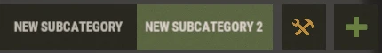
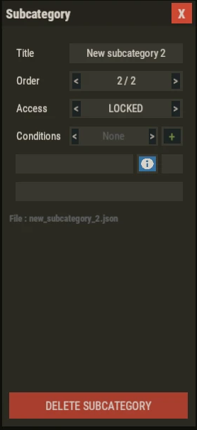
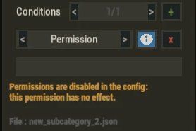
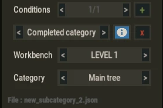

# Subcategories

**Subcategories** are extra trees shown as tabs under a workbench level.

Each workbench keeps its **main tree**, and can have as many subcategories as you want.

Use them for themed branches, professions, VIP trees, or progression unlocked later.

---

## Create A Subcategory

- Switch to `EDIT MODE` on the workbench you want.
- Click the green `+` at the end of the subcategory row.
- Set the title and the access in the settings modal.
- Build the tree like any other tree.
- Click `SAVE`.

A new subcategory starts empty.

---

## Subcategory Settings

Select the subcategory tab, then click the orange tools button.

- `Title`: name of the tab, up to 32 characters.
- `Order`: position of the tab. The main tree always stays first.
- `Access`: `LOCKED`, `HIDDEN` or `PUBLIC`.
- `Conditions`: what a player needs to open the subcategory.
- `File`: name of the data file of this subcategory.
- `DELETE SUBCATEGORY`: removes the subcategory after confirmation.

The file is deleted when you click `SAVE`.

---

## Access

**PUBLIC**

- Every player can open the subcategory.

**LOCKED**

- The tab is shown with a padlock.
- Hovering it lists the conditions.
- Players who do not meet the conditions cannot open it.

**HIDDEN**

- The tab is not shown to players who do not meet the conditions.

`LOCKED` and `HIDDEN` only apply when at least one condition exists.

Admins always see and edit every subcategory.

---

## Conditions

Click `+` next to `Conditions` to add one.

A player must meet **all** the conditions.

**Permission**

- The player needs this permission.
- It requires `"Use Permissions ?": true` in the config.
- If permissions are disabled, an orange note says the condition has no effect.

**Completed category**

- The player must have unlocked every node of another tree.
- Choose the `Workbench`, then the `Category`: `Main tree` or a subcategory.
- This condition works even when permissions are disabled.

---

## Node IDs And Progression

All trees of a workbench share the same node ID space.

A node ID is unique across the main tree and every subcategory of that workbench.

Player progression is stored per workbench, so player data does not change when you add subcategories.

---

## Vanilla Sync

Vanilla synchronization only applies to the **main tree**.

Subcategories never receive vanilla imports.

These buttons are only shown on the main tree:

- `Auto vanilla synchronization`.
- `Recover Vanilla Nodes`.
- `Reset to Vanilla`.
- `Excluded Nodes`.

---

## Good To Know

- Renaming a subcategory also renames its data file.
- `Completed category` conditions that point to it are updated automatically.
- Subcategory rewards for completing the whole tree can be set in the data file. See **Data Files**.
