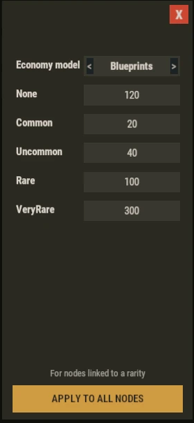
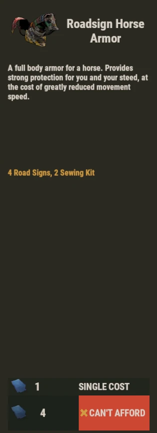

# Pricing And Economy

This page explains how a node price is chosen, and how the player pays for it.

---

## Rarity Price Or Custom Price

Each node has a price and a currency.

The price is either:

- **Linked to a rarity**: `None`, `Common`, `Uncommon`, `Rare` or `VeryRare`.
- **Custom**: a fixed amount you type yourself.

Nodes linked to a rarity all use the shared **rarity price table**.

Change one value in the table, and every node of that rarity follows.

Vanilla nodes are imported with the rarity of their item.

Set the rarity in the `Economy` tab of the node modal. See **Admin Editor**.

---

## Rarity Prices Panel

Open it with the gear button next to `Rarity` in the `Economy` tab.



- `Economy model`: `Legacy` or `Blueprints`.
- One price per rarity.
- `APPLY TO ALL NODES`: saves the table and updates every node linked to a rarity.

Custom prices are never changed by the table.

Default table:

```json
"Price by rarity": {
  "None": 120,
  "Common": 20,
  "Uncommon": 40,
  "Rare": 100,
  "VeryRare": 300
}
```

---

## Economy Models

TechTree has two economy models.

Changing the model is saved immediately and applies to every open TechTree, without reload.

**Blueprints** (default)

- Follows Rust's blueprint research system.
- Nodes linked to a rarity, paid in scrap and using an item image use the vanilla research cost.
- They are paid with the research item of the workbench level.
- `Workbench_1` and `Engineering`: blueprint fragments.
- `Workbench_2`: blueprint pages.
- `Workbench_3`: blueprint books.

**Legacy**

- Nodes linked to a rarity use the rarity price table.
- They are paid in their own currency, scrap by default.

In both models:

- Custom prices are never changed.
- Nodes with a currency other than standard scrap are never changed.
- Switching models does not rewrite your saved data.



---

## Path Unlock

When a player selects a locked node deep in a branch, TechTree finds the cheapest chain of locked parents.

The whole chain is bought at once.

If the chain uses several currencies, each currency is shown and paid separately.

`SINGLE COST` shows the price of the selected node alone.

---

## Workbench Upgrades

TechTree reads the upgrades installed on the workbench.

**Cost multiplier**

- Applied to the total cost.

**Salvage**

- The player must still own the full cost.
- Each unit then has a chance to be saved and not taken.
- Applies to normal unlocks and prototypes.

**Prototype**

- Adds a `PROTOTYPE` button on locked nodes that are not root nodes.
- Unlocks only that node, without its parents.
- Costs the node price times the prototype cost multiplier.
- Can fail. On failure the cost is lost and the node stays locked.

---

## Final Cost Order

For each currency, the cost is computed in this order:

- Base price: rarity table, custom price, or Blueprints research cost.
- Workbench cost multiplier.
- `OnNodeUnlockCost` hook from other plugins. See **API And Hooks**.
- `techtree.unlock.free` permission: the cost becomes 0.

When paying, Salvage may save some units.

---

## Good To Know

- The cost is fixed when the unlock starts.
- Changing prices during an unlock does not change what the player pays.
- Items are taken from the main inventory, then the belt, then the clothing slots.
- The `Economy` tab shows the rarity table price. In Blueprints, the player may pay another amount and currency.
