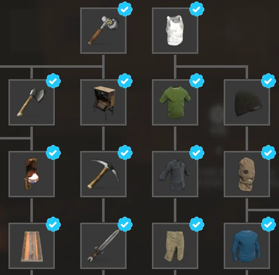
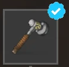

# Vanilla Sync And Custom Trees

This page explains the difference between **vanilla nodes**, **custom nodes**, and vanilla synchronization.

The important point is simple:

**Vanilla nodes are tracked by Rust vanilla IDs. Custom nodes are not.**

That difference controls what TechTree can synchronize, recover, import, or ignore.

---

## Vanilla Nodes

**Vanilla nodes** come from Rust's original Facepunch tech tree.

They have a `vanilla ID`.

That `vanilla ID` allows TechTree to recognize the node later.

In the editor, a node with the blue badge is a **vanilla node**.

If a node does not have this badge, it is a **custom node**.

Vanilla nodes can still be fully edited.

You can change:

- Price.
- Currency.
- Position.
- Parent.
- Permission.
- Rewards.
- Image.
- Name.
- Description.

The badge does not mean the node is locked from editing.

It only means TechTree knows this node is linked to Rust vanilla data.

---

## Custom Nodes

**Custom nodes** are created by you inside the TechTree editor.

They do not come from Rust's vanilla tree.

They do not have a `vanilla ID`.

Because they are not linked to Facepunch data, vanilla synchronization does not restore, recover, or replace them.

Custom nodes are mainly useful for:

- Custom items.
- Plugin rewards.
- Special server progression.
- Profession branches.
- VIP paths.
- Economy rewards.
- Command unlocks.
- Server-specific content.

A custom node can reproduce a vanilla unlock if you really want to, but that is usually not the main reason to use custom nodes.

---

## Mixing Both

You can mix vanilla nodes and custom nodes in the same tree.

Example:

- Keep most vanilla nodes.
- Modify vanilla prices or positions.
- Add custom nodes for special rewards.
- Add profession or VIP branches.
- Add custom item progression.

This is usually the best setup when you want Rust progression to stay familiar while still adding your own server identity.

---

## Vanilla Import At Load

Each time the plugin loads, TechTree compares the **main tree** of each workbench with Rust's vanilla tree.

Unless `Disable Future Vanilla Imports` is enabled:

- Vanilla nodes that no longer exist in Rust are removed.
- Missing vanilla nodes that are not excluded are added.

Subcategories are never affected. See **Subcategories**.

---

## Auto Vanilla Synchronization

**Auto Vanilla Synchronization** is useful when you want a tree to stay close to vanilla Rust.

When it is enabled, missing vanilla nodes are placed near their vanilla parent.

If the cell is already used, TechTree shifts the node to resolve the conflict.

When it is disabled, a missing vanilla node whose cell is already used is skipped, with a warning in the server console.

Use this when you want to keep receiving future Facepunch additions automatically.

After each Facepunch update, check the tree layout.

---

## Recover Vanilla Nodes

When vanilla nodes are missing from the main tree and are not excluded, the editor shows `Recover Vanilla Nodes`.

It adds the missing nodes back, after confirmation.

In the editor, a node with a red outline sits where a missing vanilla node should go.

---

## Reset To Vanilla

`Reset to Vanilla` rebuilds the main tree of the workbench from Rust's vanilla tree, after confirmation.

**Important:** the reset is saved immediately, and the current edit session is cancelled.

Unsaved changes on every workbench are lost.

---

## Disable Future Vanilla Imports

**Disable Future Vanilla Imports** means the workbench tree should stop accepting future vanilla imports.

Use it when:

- The tree is fully custom.
- You do not want Facepunch updates to change the server progression.
- You want a stable layout for a wipe or season.

This option is especially important when removing vanilla nodes.

The full removal workflow is explained in **How To Correctly Exclude Vanilla Nodes**.

---

## Good To Know

- Vanilla nodes and custom nodes can both use rewards, permissions, images, prices, and custom text.
- The difference is not what you can edit.
- The difference is whether the node has a `vanilla ID`.
- Only vanilla nodes are affected by vanilla synchronization.
- Custom nodes are not restored by vanilla synchronization.
